# Seans Arası

[](https://github.com/farukberke/innerspace/actions/workflows/ci.yml)

**A between-sessions notebook for people in therapy or psychiatric care:** clients log what happens between appointments, and an AI assistant turns their own entries into a short, source-cited summary that they review, approve and choose to share with their clinician.

> [!WARNING]
> **Portfolio project, synthetic data only.** Seans Arası is not a medical device, does not diagnose, and does not provide treatment or crisis support. Do not enter real personal or health information. If you are in crisis, contact your local emergency number (112 in Türkiye).

**Live demo:** https://seansarasi.online (Turkish UI). Demo accounts (synthetic client, clinician and clinic admin) are available on request. The free instance may take a minute to wake up.

## Screenshots

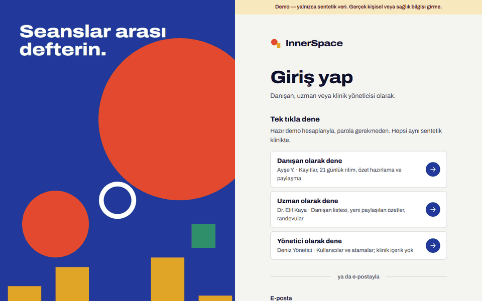

| | |
|---|---|
| 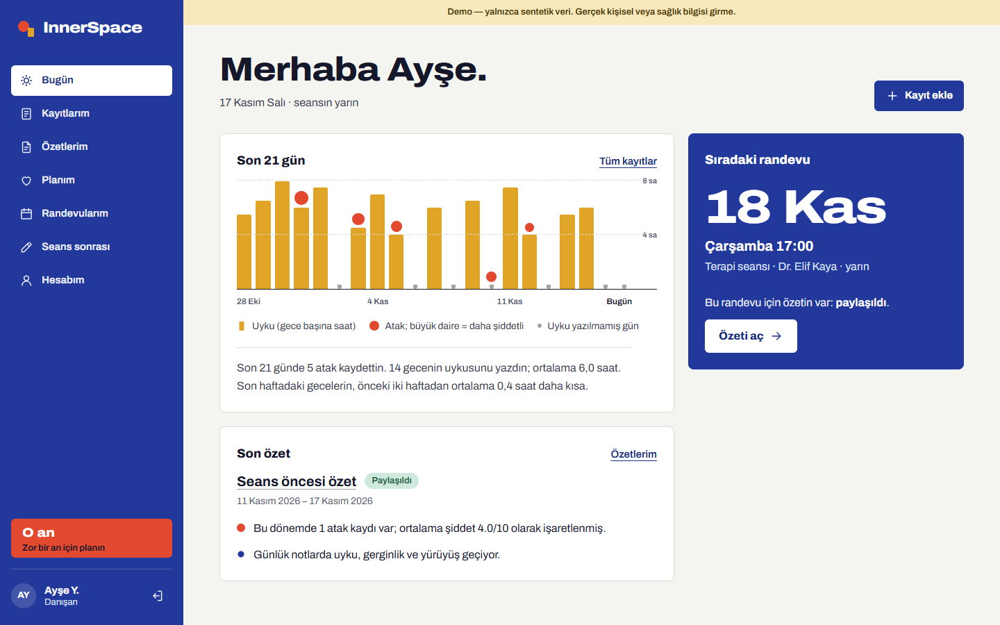 | 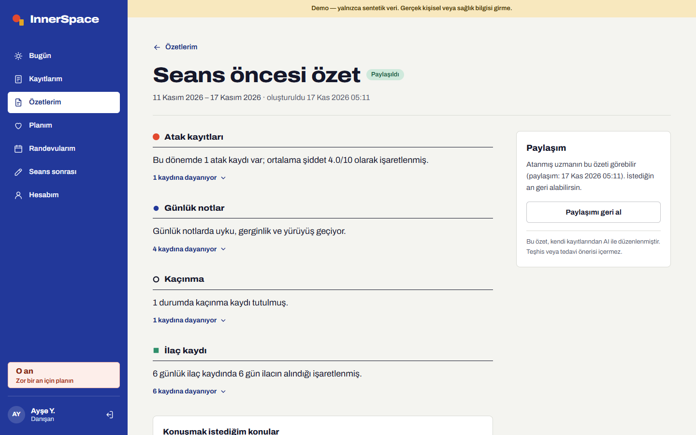 |
| 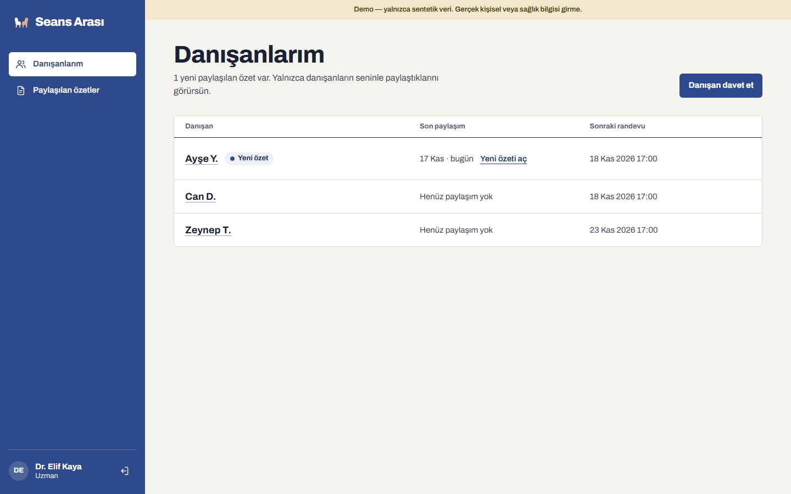 | 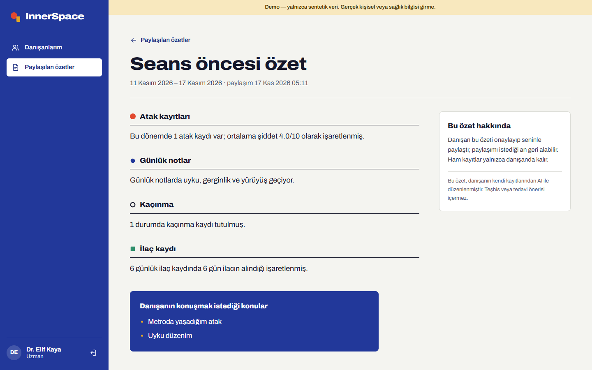 |
| 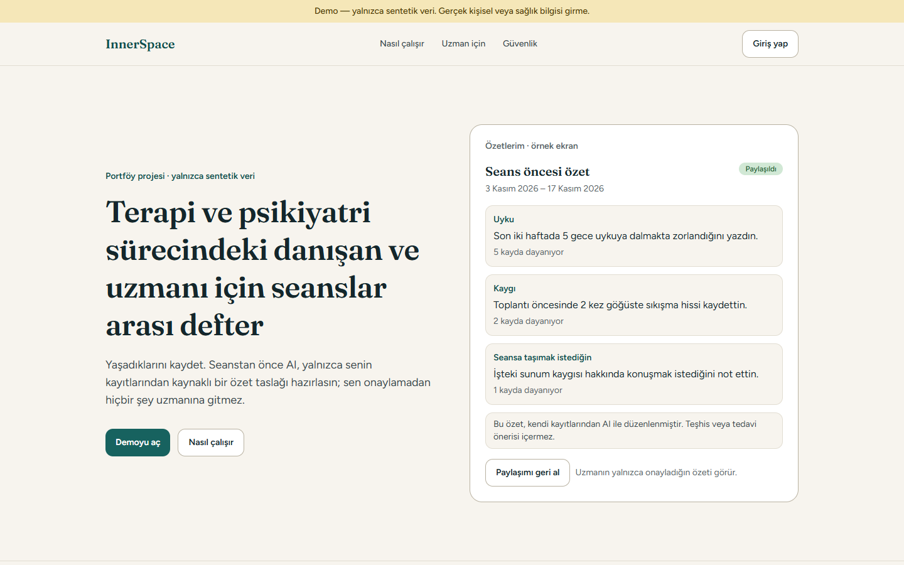 | 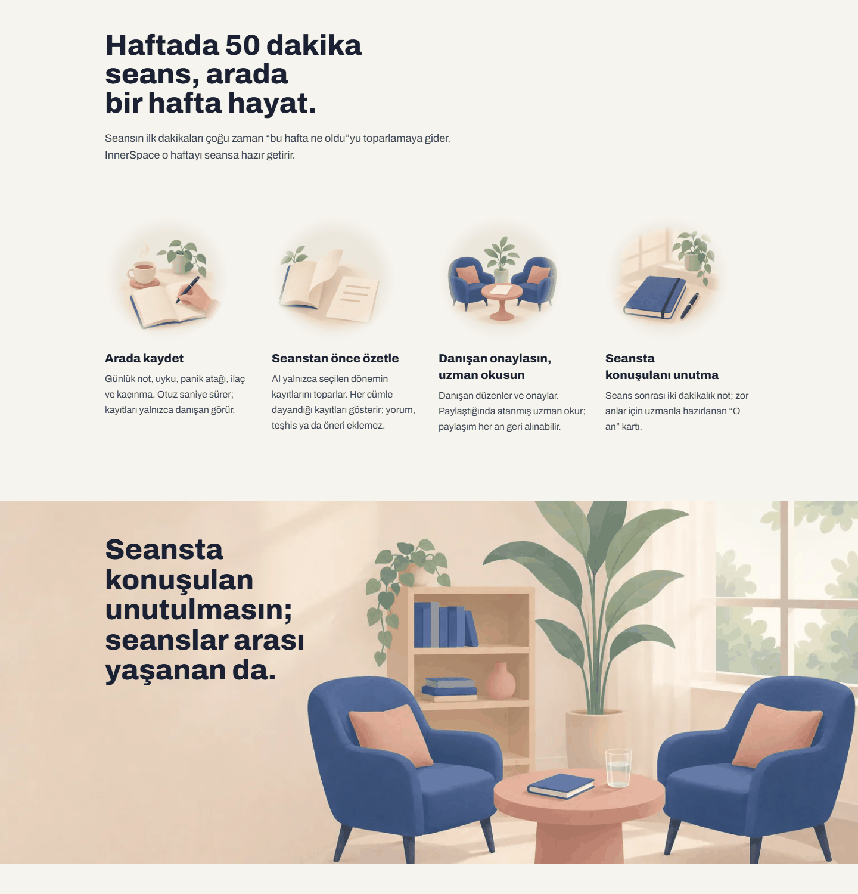 |
| 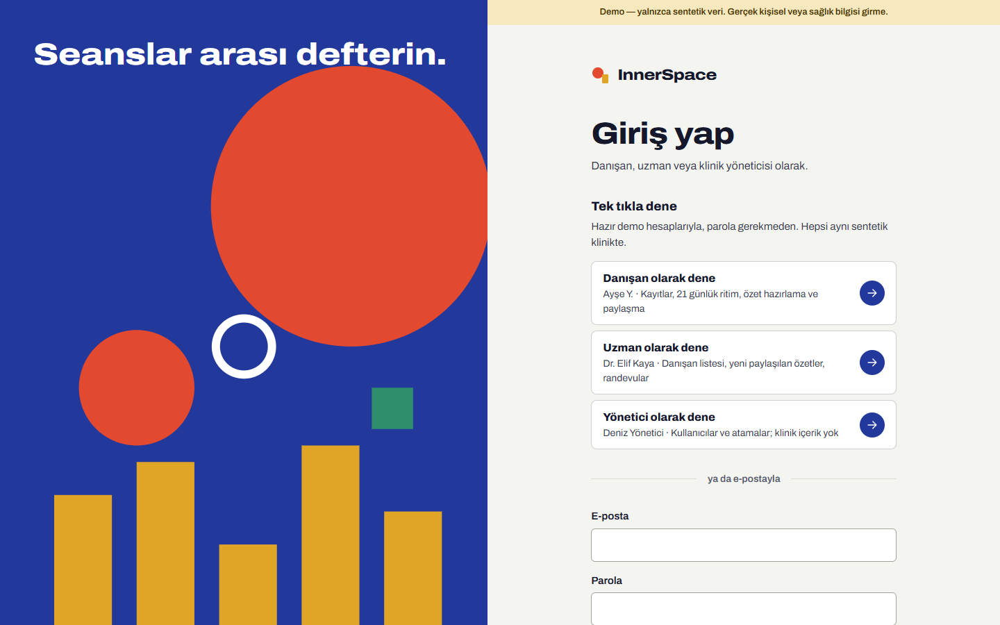 | 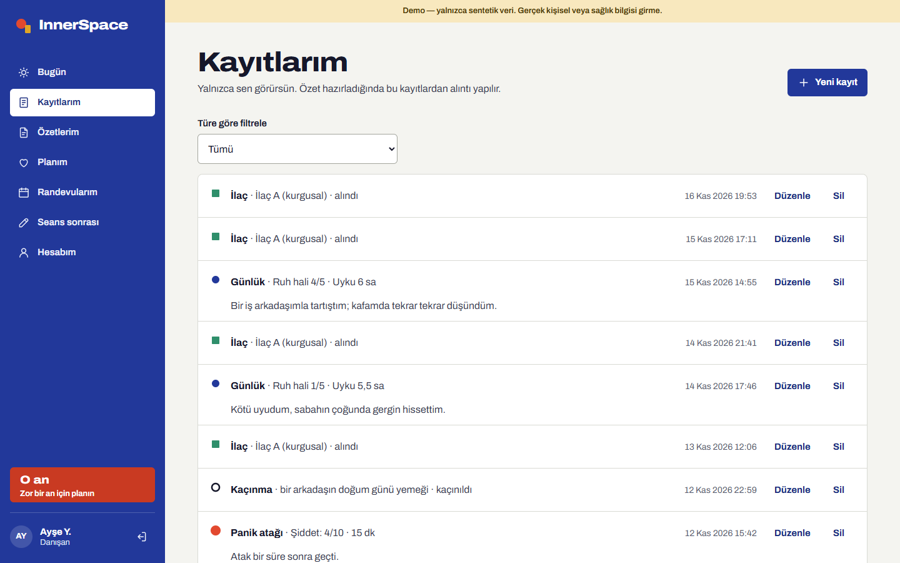 |
| 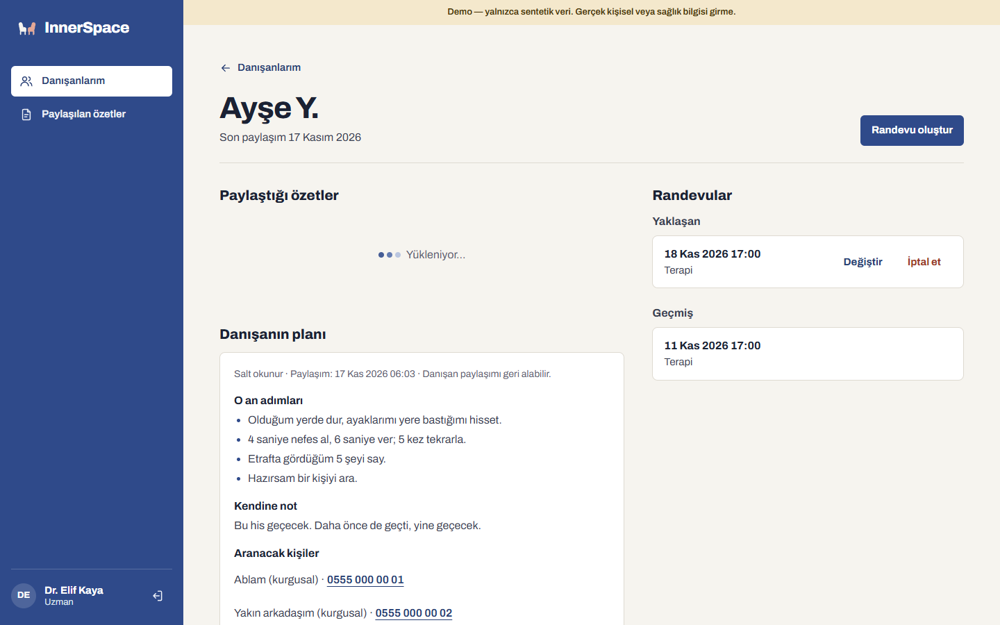 | 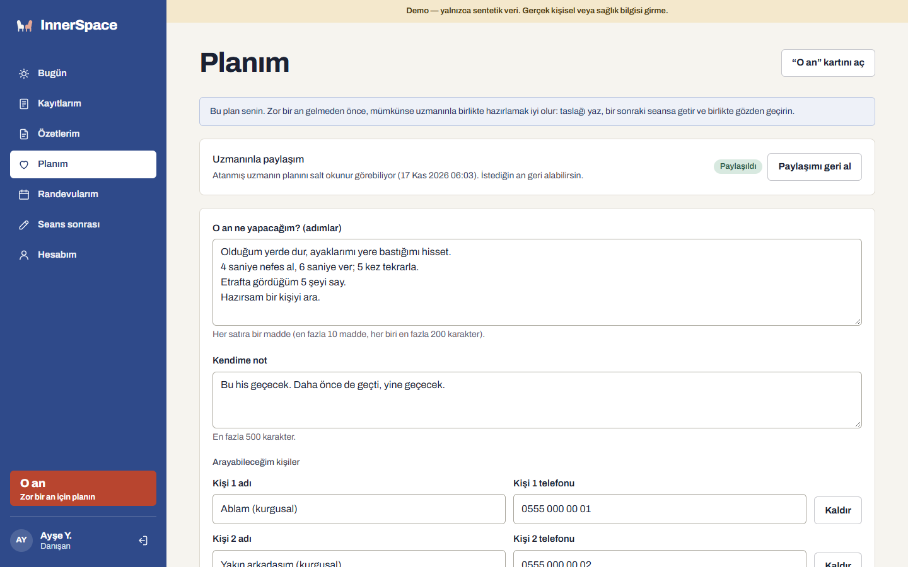 |
| 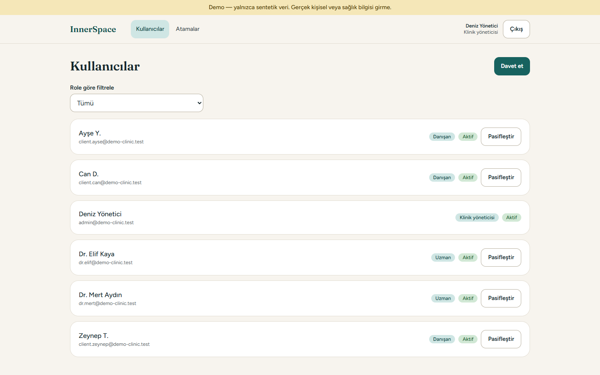 | |

| Phone | | |
|---|---|---|
| 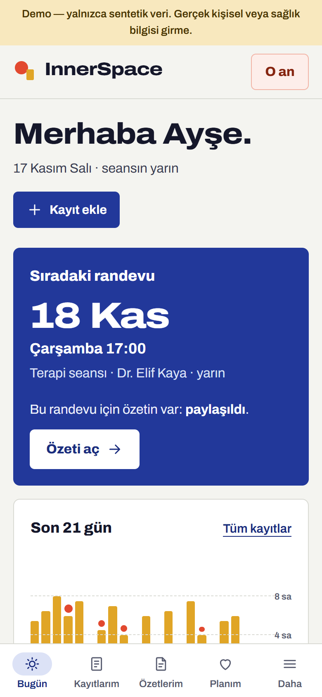 | 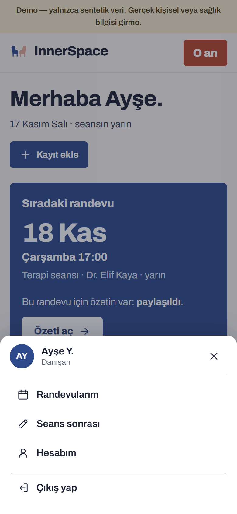 | 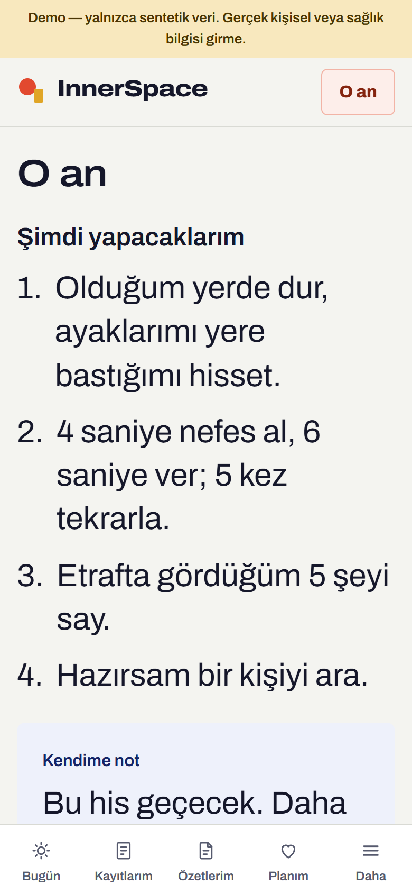 |

The visual language is a quiet therapy room: a soft cobalt shell on warm off-white, one typeface (Archivo), and a logo of two armchairs facing each other. The landing cover, sign-in panel and "how it works" illustrations are generated (GPT-6 Astra, one flat editorial style, no faces, no real data). Inside the app, colour beyond the shell appears only where it encodes data: each record kind has one mark (attack disc sized by intensity, sleep bar, medication square, avoidance ring), used the same way in the trend strip, entry list and summaries.

## Features

**Client**
- **Home ("Bugün"):** the next appointment with a one-tap "prepare" or "open summary", the last summary, and a 21-day strip of recorded sleep and attacks (computed from the client's own entries, no AI), described in plain sentences rather than scores.
- **Entries:** quick entries (with optional sleep hours), panic episode logs, medication and side-effect notes, avoidance notes. Visible only to the client.
- **AI summary:** pre-appointment summary where every statement cites the client's own entries (each statement opens those entries). The client edits, approves and shares it; sharing can be revoked. The client can add their own "topics to talk about" (never AI-written, same guardrails).
- **After-session note:** a short note structured into "what we discussed / what I'll try / questions for next time".
- **Appointments:** read-only for the client; a summary can be prepared for a specific appointment.
- **"Planım" and the "O an" card:** a support plan written by the client, with a card for difficult moments; optionally shared read-only with the clinician.
- **Crisis protocol:** if crisis language is detected, no AI content is generated and a fixed, pre-written screen is shown (with the client's own plan contacts).
- **Reminders:** calm in-app nudges (no push or e-mail): an appointment tomorrow without a prepared summary, or yesterday's session without a note.
- **Data rights:** download all data as JSON; permanently delete the account (password + typed confirmation). The audit log keeps only a content-free event.

**Clinician**
- Sees assigned clients and only the summaries (and plan) a client has approved and shared; creates, edits and deletes appointments of assigned clients.
- The client list shows each client's last share date and how many shared summaries are new (not opened since they were shared or re-shared), with a direct link to the newest one. Opening a summary records a content-free read receipt.

**Clinic admin (`org_admin`)**
- Invites users, activates/deactivates them and manages clinician-client assignments. Sees no clinical content.

## Architecture

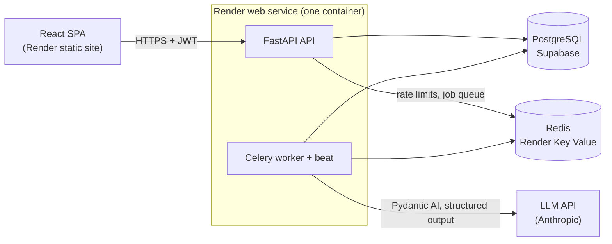

Request flow: **JWT auth** (`get_current_user`) → **role check** (`require_role`) → **service layer**, where every query is scoped by owner and organization (for clinicians also by an active assignment and an explicit share) → **audit log** (events only, no content). AI generation runs as a background job (Celery) with rate limits and a per-user LLM budget.

Backend layout: `app/api` (routes, dependencies), `app/services` (business rules, scoped queries), `app/ai` (agents, crisis detection, guardrails), `app/models`, `app/schemas`, `app/core` (settings, logging, rate limiting, tracing), `alembic/`, `evals/`, `tests/`.

## Authorization matrix

Enforced in the backend (role dependencies + scoped queries), never by the LLM. "Assigned clinician" = the clinician with an active assignment to that client in the same organization.

| Resource | Client (owner) | Assigned clinician | Other clinician | Org admin | Other organization |
|---|---|---|---|---|---|
| Entries (log, panic, medication, avoidance) | read/write | none | none | none | none |
| Summary drafts, unshared summaries, topics | read/write/approve | none | none | none | none |
| Shared summary (incl. topics) | read, unshare | read-only, only while shared (and shared after the assignment began) | none | none | none |
| Sharing metadata (last share date, new count) | n/a | read, counting only summaries it may read | none | none | none |
| After-session notes | read/write | none | none | none | none |
| Appointments | read-only | read/write (create, edit, delete) | none | none | none |
| Plan ("Planım") | read/write | none | none | none | none |
| Shared plan | read/write, unshare | read-only, only while shared | none | none | none |
| Users and assignments management | none | none | none | read/write (own org only) | none |
| Export / delete account | own data only | none | none | none | none |

Covered by: `backend/tests/test_auth_rbac.py` (roles, isolation, admin, invitations), `test_planning.py` (appointments and plan: assigned / unassigned / other org / admin), `test_phase8.py` (topics, reminders, export, delete), `test_ai.py` and `test_jobs.py` (summary generation, sharing and job access), `test_entries.py`, `test_sharing_overview.py` (sharing overview isolation), `test_predeploy_fixes.py`, and `test_observability.py` (no content in logs).

## AI safety

- **The LLM never authorizes.** The backend decides who may see what; AI tools return only the requesting client's data.
- **Structured output and source checks:** output must match a Pydantic schema, and statements must cite real entries of that client.
- **Guardrails:** summaries, notes and topics are checked for diagnosis, medication/dose and treatment advice; violating output is rejected and nothing is stored.
- **Crisis detection** (`app/ai/crisis.py`): runs before the model; on a hit, AI does not run and a fixed screen is returned.
- **Prompt injection:** entry text is treated as untrusted data, never as instructions; the injection eval checks that a "model that obeys" cannot get anything stored.
- **Human-in-the-loop:** nothing is shared without the client's approval; sharing is revocable.
- **No sensitive content in logs or LLM traces:** JSON logs without content; Logfire tracing (only when `LOGFIRE_TOKEN` is set) has content export disabled.

**Evaluation** (`backend/evals/`, synthetic Turkish and English data, enforced by `tests/test_evals.py`): crisis detection (zero false negatives required), guardrail recall and false positives, prompt injection, citation faithfulness. Offline run on 2026-11-17 (`cd backend && uv run python -m evals.offline`):

| Eval | Result |
|---|---|
| Crisis detection | 43 TP, 0 FN, 0 FP, 38 TN (recall 1.0) |
| Guardrails | 31 TP, 0 FN, 1 FP, 23 TN (recall 1.0, precision 0.97) |

The injection and citation evals run as assertions in `tests/test_evals.py` (`pytest -s tests/test_evals.py`). A paid, real-model evaluation exists (`uv run python -m evals.run_live --max-requests N`); it is never run by tests or CI, and no recorded results are published.

## Design decisions

- **Synthetic data only.** Why: no real health data in a portfolio project. Cost: demo content is fictional; the code is still written to production standards.
- **B2B2C (clinic, clinician, client).** Why: mirrors how care is organized and makes isolation a real problem to solve. Cost: more roles and assignment logic.
- **Simple monolith (FastAPI).** Why: one deployable unit is easy to reason about and test. Cost: API and worker scale together.
- **The LLM does no authorization.** Why: a model cannot be a trust boundary. Cost: more backend code for scoped tools and checks.
- **No AI in "Planım".** Why: the plan is the client's own words for hard moments; generated text there would be risky. Cost: no assistance writing it.
- **No external calendar or appointment sync.** Why: out of scope and avoids third-party health-data flows. Cost: clinicians enter appointments manually.
- **One Render service (API + worker + beat) with Supabase.** Why: the demo costs about $7/month. Cost: tight 512 MB memory; API and worker restart together.
- **Sharing is a revocable permission record.** Why: the client keeps control; a clinician sees a summary only if it was shared after their assignment began. Cost: a newly assigned clinician sees nothing until the client shares again.
- **No content in the audit log.** Why: the log must be safe to keep and review, even after account deletion. Cost: less detail when investigating.

## Tech stack

- **Backend:** Python 3.13, FastAPI, Pydantic, SQLAlchemy (async), Alembic, PostgreSQL
- **AI:** Pydantic AI, Anthropic, structured outputs, guardrails, offline evals
- **Jobs and limits:** Redis, Celery (worker + beat), Redis-backed rate limiting
- **Frontend:** React, TypeScript, Vite, Tailwind CSS
- **Ops:** Docker, Docker Compose, GitHub Actions, Render (`render.yaml`), Logfire, Prometheus-style `/metrics`
- **Tooling:** uv, ruff, pytest, vitest, pre-commit, gitleaks, pip-audit

## Testing

```bash
cd backend && uv run pytest -q    # 487 passed (real PostgreSQL)
cd frontend && npx vitest run     # 76 passed (11 test files)
```

CI (`.github/workflows/ci.yml`) runs on every push and PR: backend (Postgres + Redis, migrations, pytest, ruff, pip-audit), frontend (lint, tests, build, npm audit) and a Docker image build.

## Local development

Requirements: [uv](https://docs.astral.sh/uv/), Docker, Node.js, Git.

```bash
cp .env.example .env          # set your own local POSTGRES_PASSWORD / DATABASE_URL / JWT_SECRET
docker compose up -d db redis # PostgreSQL on localhost:5433 (+ a test database), Redis on 6380
cd backend
uv sync
uv run pre-commit install     # secret scanning and lint checks before each commit
uv run alembic upgrade head
uv run python -m app.seed     # synthetic demo data; prints a random password unless SEED_PASSWORD is set
uv run uvicorn app.main:create_app --factory --reload
```

```bash
cd frontend
cp .env.example .env          # VITE_API_URL, default http://localhost:8000
npm ci && npm run dev         # http://localhost:5173 (set CORS_ORIGINS=http://localhost:5173 in the root .env)
```

API docs at http://localhost:8000/docs (disabled in production); health at `/health` and `/health/ready`. There is no open sign-up: accounts are created from invitations (the one-time code is shown to the inviter until e-mail delivery exists). Full stack in containers: `docker compose up --build`.

Frontend notes: the access token lives in memory only; the refresh token is in `sessionStorage` and rotates on every use; tokens are never put in URLs.

## Deployment

Render Blueprint (`render.yaml`): one web service running the API plus a thread-pool Celery worker and beat, a static site for the frontend, Render Key Value (Redis) and Supabase PostgreSQL. Step-by-step setup, environment variables, demo seeding, rate-limit and proxy notes, and the production checklist are in [DEPLOYMENT.md](DEPLOYMENT.md).

## Project status

Phases 0-8 are complete: repository and tooling, backend foundation, authentication and authorization, AI summaries, background jobs, evaluation and observability, Docker/CI/Render, appointments and support plan, and topics, reminders, data export and deletion. The React frontend covers client, clinician and clinic-admin screens; it was redesigned afterwards (new visual identity, client home, clinician sharing status).

## License

Copyright © 2026. All rights reserved. The source is public for review; no license is granted for reuse.
