# Seans Arası

[English](README.md) · **Türkçe**

[](https://github.com/farukberke/seansarasi/actions/workflows/ci.yml)

**Terapi veya psikiyatri sürecindeki kişiler için seanslar arası defter:** danışan, seanslar arasında yaşadıklarını kaydeder. Bir yapay zekâ asistanı bu kayıtlardan, her cümlesi kaynağını gösteren kısa bir özet hazırlar. Danışan özeti gözden geçirir, onaylar ve isterse uzmanıyla paylaşır.

> [!WARNING]
> **Yalnızca sentetik veri.** Seans Arası tıbbi bir cihaz değildir; teşhis koymaz, tedavi veya kriz desteği sağlamaz. Gerçek kişisel veya sağlık bilgisi girmeyin. Kriz anındaysanız 112'yi arayın.

**Canlı demo:** https://seansarasi.online. Demo hesapları (sentetik danışan, uzman ve klinik yöneticisi) istek üzerine verilir. Sunucunun uyanması bir dakika kadar sürebilir.

## Ekran görüntüleri

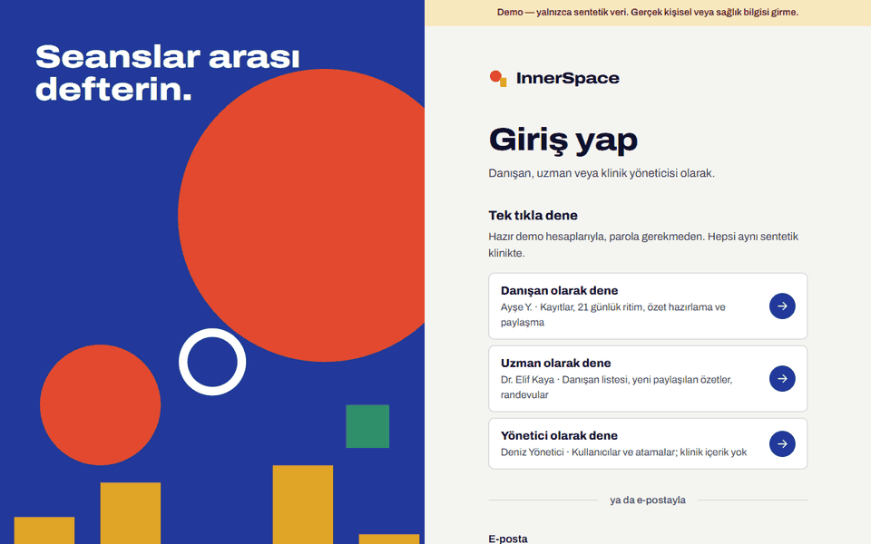

| | |
|---|---|
| 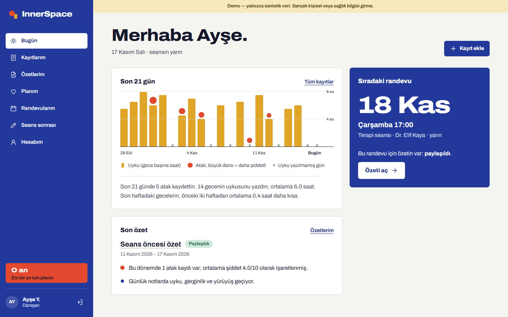 | 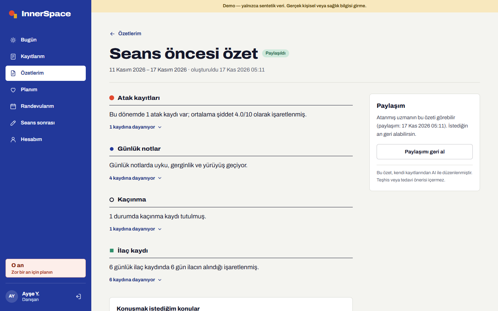 |
| 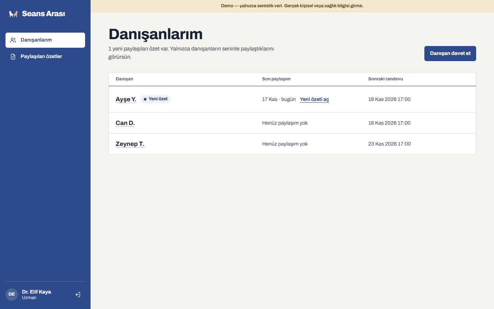 | 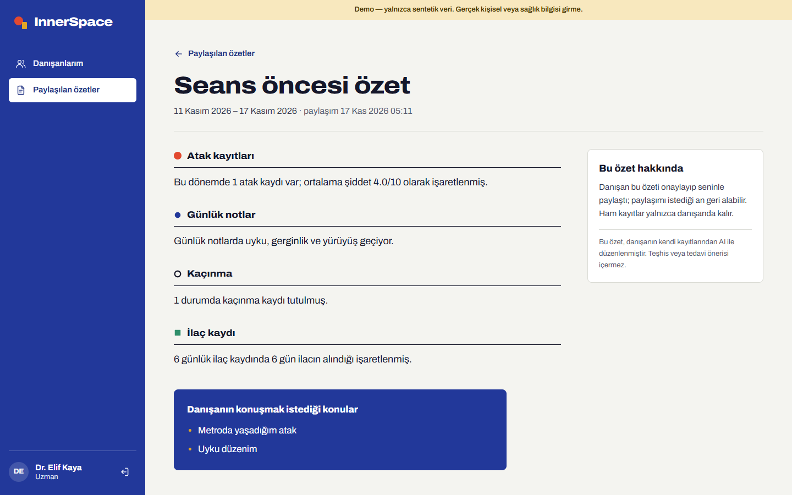 |
| 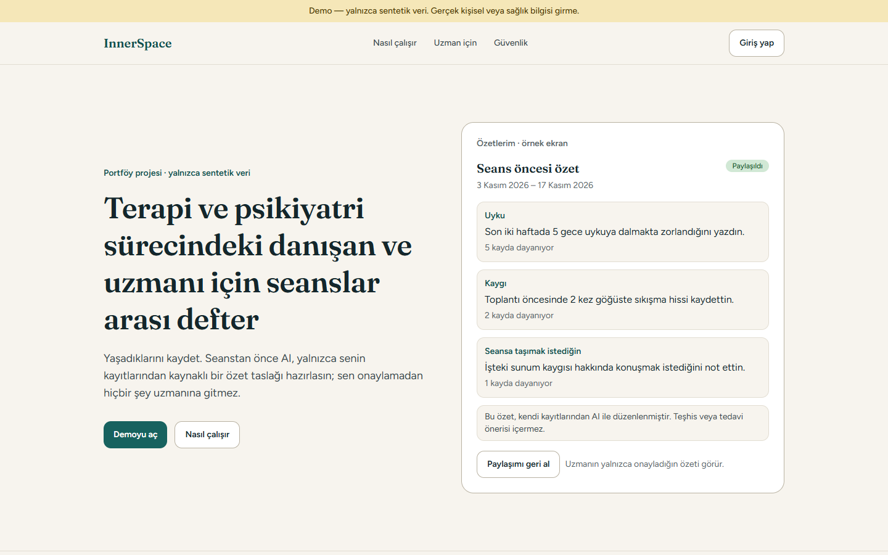 |  |
| 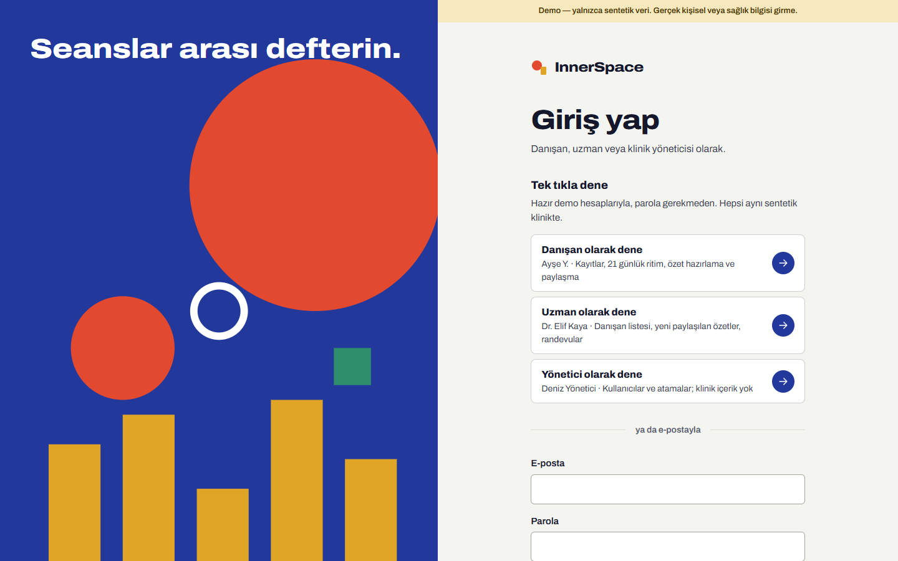 | 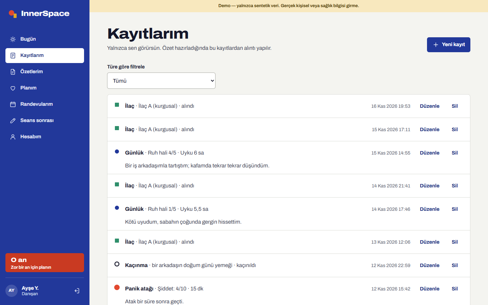 |
| 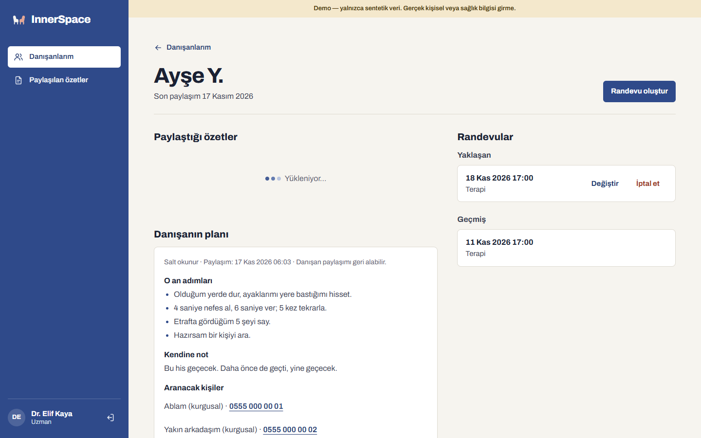 | 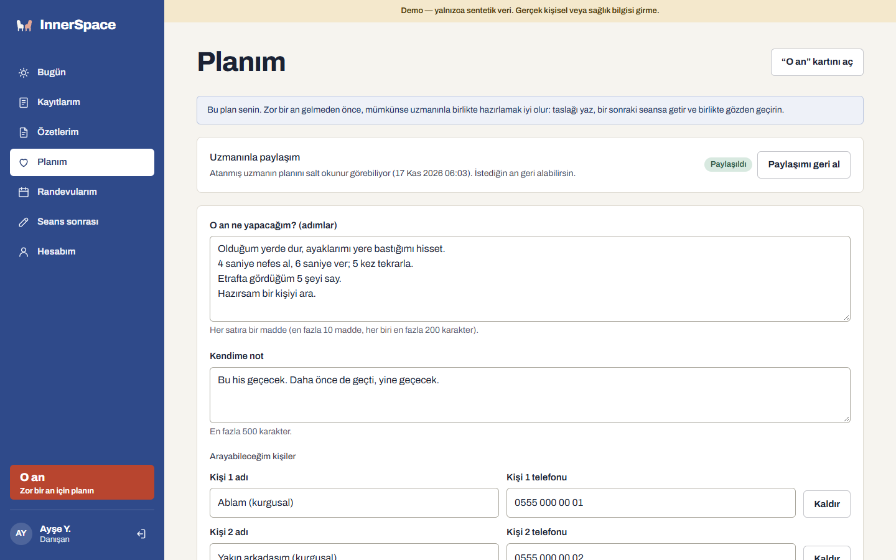 |
| 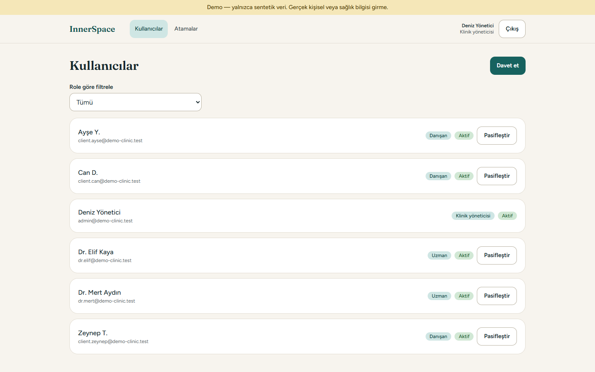 | |

| Telefon | | |
|---|---|---|
| 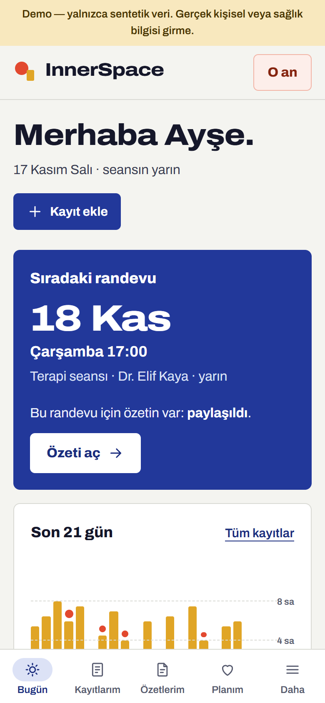 | 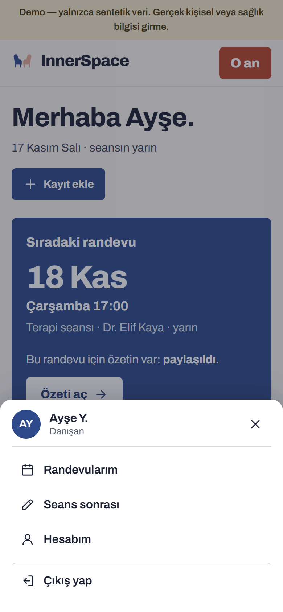 | 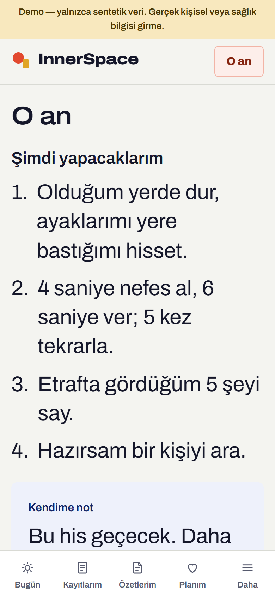 |

Görsel dil sakin bir terapi odasından esinleniyor: sıcak kırık beyaz zemin üzerinde yumuşak kobalt mavisi, tek yazı tipi (Archivo) ve birbirine bakan iki koltuktan oluşan bir logo. Tanıtım sayfası kapağı, giriş paneli ve "nasıl çalışır" görselleri yapay zekâyla üretildi (GPT-6 Astra; tek bir düz illüstrasyon stili, yüz yok, gerçek veri yok). Uygulamanın içinde renk yalnızca veri gösterdiği yerde kullanılır: her kayıt türünün tek bir işareti var (şiddetine göre boyutlanan atak diski, uyku çubuğu, ilaç karesi, kaçınma halkası) ve bu işaretler trend şeridinde, kayıt listesinde ve özetlerde aynı şekilde kullanılır.

## Özellikler

**Danışan**
- **Ana sayfa ("Bugün"):** tek dokunuşla "hazırla" ya da "özeti aç" seçenekleriyle sıradaki randevu, son özet ve kaydedilen uyku ile atakların 21 günlük şeridi. Şerit danışanın kendi kayıtlarından hesaplanır, yapay zekâ kullanılmaz; puan yerine sade cümlelerle anlatılır.
- **Kayıtlar:** hızlı kayıt (isteğe bağlı uyku süresiyle), panik atağı kaydı, ilaç ve yan etki notları, kaçınma notları. Yalnızca danışan görür.
- **Yapay zekâ özeti:** her cümlesi danışanın kendi kayıtlarına dayanan seans öncesi özet; her cümleden o kayıtlara gidilebilir. Danışan özeti düzenler, onaylar ve paylaşır; paylaşım geri alınabilir. Danışan "konuşmak istediğim konular" listesini kendisi ekleyebilir (yapay zekâ yazmaz, aynı güvenlik kontrollerinden geçer).
- **Seans sonrası not:** "neler konuştuk / neyi deneyeceğim / bir sonraki seans için sorularım" başlıklarına ayrılan kısa bir not.
- **Randevular:** danışan için salt okunur; belirli bir randevu için özet hazırlanabilir.
- **"Planım" ve "O an" kartı:** danışanın kendi yazdığı destek planı ve zor anlar için bir kart; isterse uzmanla salt okunur olarak paylaşılabilir.
- **Kriz protokolü:** kriz ifadesi saptanırsa yapay zekâ içerik üretmez; önceden yazılmış sabit bir ekran (danışanın planındaki kişilerle birlikte) gösterilir.
- **Hatırlatmalar:** uygulama içinde sakin uyarılar (bildirim veya e-posta yok): yarın randevu var ama özet hazırlanmadı, ya da dünkü seansın notu yazılmadı.
- **Veri hakları:** tüm verileri JSON olarak indirme; hesabı kalıcı olarak silme (parola ve yazılı onay ile). Denetim kaydında yalnızca içeriksiz bir olay kalır.

**Uzman**
- Kendisine atanmış danışanları ve yalnızca danışanın onaylayıp paylaştığı özetleri (ve planı) görür; atanmış danışanlarının randevularını oluşturur, düzenler ve siler.
- Danışan listesinde her danışanın son paylaşım tarihi ve kaç paylaşılmış özetin yeni olduğu (paylaşıldığından ya da yeniden paylaşıldığından beri açılmamış) görünür; en yenisine doğrudan bağlantı vardır. Bir özeti açmak içeriksiz bir okundu kaydı oluşturur.

**Klinik yöneticisi (`org_admin`)**
- Kullanıcıları davet eder, etkinleştirir veya devre dışı bırakır ve uzman-danışan atamalarını yönetir. Hiçbir klinik içeriği görmez.

## Mimari

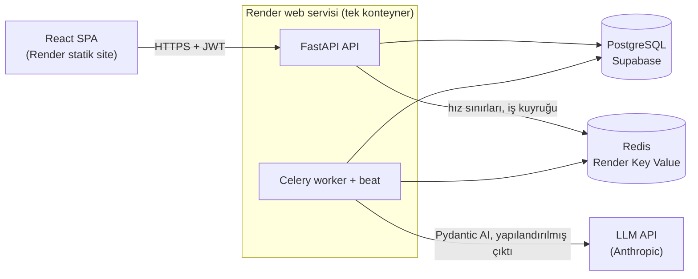

İstek akışı: **JWT kimlik doğrulama** (`get_current_user`) → **rol kontrolü** (`require_role`) → **servis katmanı**; burada her sorgu sahibine ve organizasyona göre sınırlanır (uzmanlar için ayrıca etkin bir atama ve açık bir paylaşım aranır) → **denetim kaydı** (yalnızca olaylar, içerik yok). Yapay zekâ üretimi, hız sınırları ve kullanıcı başına LLM bütçesiyle arka plan işi (Celery) olarak çalışır.

Backend yapısı: `app/api` (rotalar, bağımlılıklar), `app/services` (iş kuralları, sınırlanmış sorgular), `app/ai` (ajanlar, kriz tespiti, güvenlik kontrolleri), `app/models`, `app/schemas`, `app/core` (ayarlar, loglama, hız sınırlama, izleme), `alembic/`, `evals/`, `tests/`.

## Yetki matrisi

Backend'de uygulanır (rol bağımlılıkları ve sınırlanmış sorgular), hiçbir zaman LLM'e bırakılmaz. "Atanmış uzman", aynı organizasyonda o danışana etkin bir ataması olan uzmandır.

| Kaynak | Danışan (sahibi) | Atanmış uzman | Diğer uzman | Klinik yöneticisi | Başka organizasyon |
|---|---|---|---|---|---|
| Kayıtlar (günlük, panik, ilaç, kaçınma) | okuma/yazma | yok | yok | yok | yok |
| Özet taslakları, paylaşılmamış özetler, konular | okuma/yazma/onay | yok | yok | yok | yok |
| Paylaşılmış özet (konular dahil) | okuma, paylaşımı geri alma | yalnızca paylaşıldığı sürece salt okuma (atamadan sonra paylaşılmışsa) | yok | yok | yok |
| Paylaşım bilgileri (son paylaşım tarihi, yeni sayısı) | yok | okuma; yalnızca okuyabildiği özetler sayılır | yok | yok | yok |
| Seans sonrası notlar | okuma/yazma | yok | yok | yok | yok |
| Randevular | salt okuma | okuma/yazma (oluşturma, düzenleme, silme) | yok | yok | yok |
| Plan ("Planım") | okuma/yazma | yok | yok | yok | yok |
| Paylaşılmış plan | okuma/yazma, paylaşımı geri alma | yalnızca paylaşıldığı sürece salt okuma | yok | yok | yok |
| Kullanıcı ve atama yönetimi | yok | yok | yok | okuma/yazma (yalnızca kendi organizasyonu) | yok |
| Veri indirme / hesap silme | yalnızca kendi verisi | yok | yok | yok | yok |

Testler: `backend/tests/test_auth_rbac.py` (roller, izolasyon, yönetici, davetler), `test_planning.py` (randevular ve plan: atanmış / atanmamış / başka organizasyon / yönetici), `test_phase8.py` (konular, hatırlatmalar, veri indirme, hesap silme), `test_ai.py` ve `test_jobs.py` (özet üretimi, paylaşım ve iş erişimi), `test_entries.py`, `test_sharing_overview.py` (paylaşım özeti izolasyonu), `test_predeploy_fixes.py` ve `test_observability.py` (loglarda içerik olmaması).

## Yapay zekâ güvenliği

- **LLM asla yetki vermez.** Kimin neyi görebileceğine backend karar verir; yapay zekâ araçları yalnızca isteği yapan danışanın verisini döndürür.
- **Yapılandırılmış çıktı ve kaynak kontrolü:** çıktı bir Pydantic şemasına uymak zorundadır ve cümleler o danışanın gerçek kayıtlarına dayanmalıdır.
- **Güvenlik kontrolleri:** özetler, notlar ve konular teşhis, ilaç/doz ve tedavi önerisi içerip içermediğine göre denetlenir; kurala uymayan çıktı reddedilir ve hiçbir şey kaydedilmez.
- **Kriz tespiti** (`app/ai/crisis.py`): modelden önce çalışır; kriz saptanırsa yapay zekâ çalışmaz ve sabit bir ekran döner.
- **Prompt injection:** kayıt metni talimat olarak değil, güvenilmeyen veri olarak ele alınır; injection değerlendirmesi, "talimatlara uyan bir modelin" bile hiçbir şey kaydettiremeyeceğini kontrol eder.
- **İnsan onayı:** danışan onaylamadan hiçbir şey paylaşılmaz; paylaşım geri alınabilir.
- **Loglarda ve LLM izlerinde hassas içerik yok:** JSON loglar içerik taşımaz; Logfire izleme (yalnızca `LOGFIRE_TOKEN` tanımlıysa) içerik aktarımı kapalı çalışır.

**Değerlendirme** (`backend/evals/`, sentetik Türkçe ve İngilizce veri, `tests/test_evals.py` ile zorunlu tutulur): kriz tespiti (sıfır yanlış negatif şartı), güvenlik kontrollerinin yakalama oranı ve yanlış pozitifleri, prompt injection, kaynak sadakati. 17.11.2026 tarihli çevrimdışı çalıştırma (`cd backend && uv run python -m evals.offline`):

| Değerlendirme | Sonuç |
|---|---|
| Kriz tespiti | 43 DP, 0 YN, 0 YP, 38 DN (yakalama oranı 1,0) |
| Güvenlik kontrolleri | 31 DP, 0 YN, 1 YP, 23 DN (yakalama oranı 1,0, kesinlik 0,97) |

(DP: doğru pozitif, YN: yanlış negatif, YP: yanlış pozitif, DN: doğru negatif.)

Injection ve kaynak değerlendirmeleri `tests/test_evals.py` içinde doğrulama olarak çalışır (`pytest -s tests/test_evals.py`). Ücretli, gerçek modelle yapılan bir değerlendirme de var (`uv run python -m evals.run_live --max-requests N`); testler veya CI tarafından hiç çalıştırılmaz ve sonuçları yayımlanmaz.

## Tasarım kararları

- **Yalnızca sentetik veri.** Neden: herkese açık bir demoda gerçek sağlık verisi olmamalı. Bedeli: demo içeriği kurgusal; kod yine de production standartlarında yazıldı.
- **B2B2C (klinik, uzman, danışan).** Neden: bakımın gerçekte nasıl organize edildiğini yansıtır ve izolasyonu gerçek bir problem hâline getirir. Bedeli: daha fazla rol ve atama mantığı.
- **Sade monolit (FastAPI).** Neden: tek bir yayınlanabilir birim, anlaşılması ve test edilmesi kolaydır. Bedeli: API ve worker birlikte ölçeklenir.
- **LLM yetkilendirme yapmaz.** Neden: bir model güven sınırı olamaz. Bedeli: sınırlanmış araçlar ve kontroller için daha fazla backend kodu.
- **"Planım"da yapay zekâ yok.** Neden: plan, danışanın zor anlar için kendi sözleridir; orada üretilmiş metin riskli olur. Bedeli: yazarken yardım yok.
- **Harici takvim veya randevu senkronizasyonu yok.** Neden: kapsam dışı ve üçüncü taraflara sağlık verisi akışını önler. Bedeli: uzmanlar randevuları elle girer.
- **Supabase ile tek Render servisi (API + worker + beat).** Neden: demo ayda yaklaşık 7 dolara mal olur. Bedeli: 512 MB bellek sınırı; API ve worker birlikte yeniden başlar.
- **Paylaşım geri alınabilir bir izin kaydıdır.** Neden: kontrol danışanda kalır; uzman bir özeti yalnızca ataması başladıktan sonra paylaşılmışsa görür. Bedeli: yeni atanan bir uzman, danışan yeniden paylaşana kadar hiçbir şey görmez.
- **Denetim kaydında içerik yok.** Neden: kayıt, hesap silindikten sonra bile saklanması ve incelenmesi güvenli olmalı. Bedeli: inceleme sırasında daha az ayrıntı.

## Teknolojiler

- **Backend:** Python 3.13, FastAPI, Pydantic, SQLAlchemy (async), Alembic, PostgreSQL
- **Yapay zekâ:** Pydantic AI, Anthropic, yapılandırılmış çıktılar, güvenlik kontrolleri, çevrimdışı değerlendirmeler
- **Arka plan işleri ve sınırlar:** Redis, Celery (worker + beat), Redis tabanlı hız sınırlama
- **Frontend:** React, TypeScript, Vite, Tailwind CSS
- **Altyapı:** Docker, Docker Compose, GitHub Actions, Render (`render.yaml`), Logfire, Prometheus tarzı `/metrics`
- **Araçlar:** uv, ruff, pytest, vitest, pre-commit, gitleaks, pip-audit

## Testler

```bash
cd backend && uv run pytest -q    # 487 geçti (gerçek PostgreSQL)
cd frontend && npx vitest run     # 76 geçti (11 test dosyası)
```

CI (`.github/workflows/ci.yml`) her push ve PR'da çalışır: backend (Postgres + Redis, migration'lar, pytest, ruff, pip-audit), frontend (lint, testler, build, npm audit) ve Docker imajı derlemesi.

## Yerel geliştirme

Gereksinimler: [uv](https://docs.astral.sh/uv/), Docker, Node.js, Git.

```bash
cp .env.example .env          # kendi yerel POSTGRES_PASSWORD / DATABASE_URL / JWT_SECRET değerlerini gir
docker compose up -d db redis # PostgreSQL localhost:5433'te (+ test veritabanı), Redis 6380'de
cd backend
uv sync
uv run pre-commit install     # her commit'ten önce gizli anahtar taraması ve lint kontrolleri
uv run alembic upgrade head
uv run python -m app.seed     # sentetik demo verisi; SEED_PASSWORD tanımlı değilse rastgele bir parola yazdırır
uv run uvicorn app.main:create_app --factory --reload
```

```bash
cd frontend
cp .env.example .env          # VITE_API_URL, varsayılan http://localhost:8000
npm ci && npm run dev         # http://localhost:5173 (kök .env'de CORS_ORIGINS=http://localhost:5173 olmalı)
```

API belgeleri http://localhost:8000/docs adresinde (production'da kapalı); sağlık kontrolleri `/health` ve `/health/ready`. Açık kayıt yok: hesaplar davetle oluşturulur (e-posta gönderimi olmadığı için tek kullanımlık kod daveti oluşturana gösterilir). Tüm sistemi konteynerlerde çalıştırmak için: `docker compose up --build`.

Frontend notları: erişim token'ı yalnızca bellekte tutulur; yenileme token'ı `sessionStorage`'dadır ve her kullanımda yenilenir; token'lar asla URL'ye konmaz.

## Yayına alma

Render Blueprint (`render.yaml`): API'yi, thread havuzlu Celery worker'ı ve beat'i çalıştıran tek bir web servisi, frontend için statik site, Render Key Value (Redis) ve Supabase PostgreSQL. Adım adım kurulum, ortam değişkenleri, demo verisi, hız sınırı ve proxy notları ile production kontrol listesi [DEPLOYMENT.md](DEPLOYMENT.md) dosyasında (İngilizce).

## Proje durumu

Faz 0-8 tamamlandı: depo ve araçlar, backend temeli, kimlik doğrulama ve yetkilendirme, yapay zekâ özetleri, arka plan işleri, değerlendirme ve gözlemlenebilirlik, Docker/CI/Render, randevular ve destek planı, konular, hatırlatmalar, veri indirme ve hesap silme. React frontend danışan, uzman ve klinik yöneticisi ekranlarını kapsar; sonrasında yeniden tasarlandı (yeni görsel kimlik, danışan ana sayfası, uzman paylaşım durumu).

## Lisans

Telif hakkı © 2026. Tüm hakları saklıdır. Kaynak kod incelenmek üzere herkese açıktır; yeniden kullanım için lisans verilmez.
